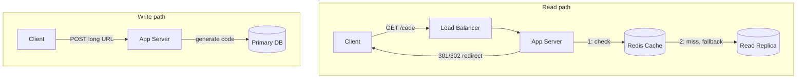
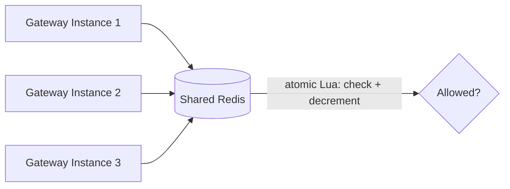
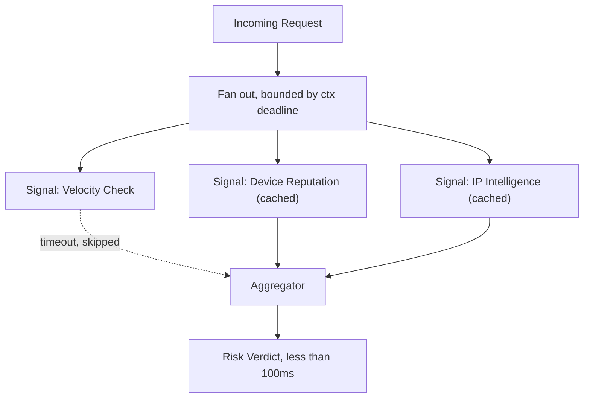
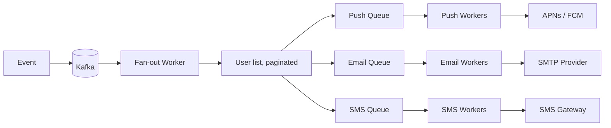
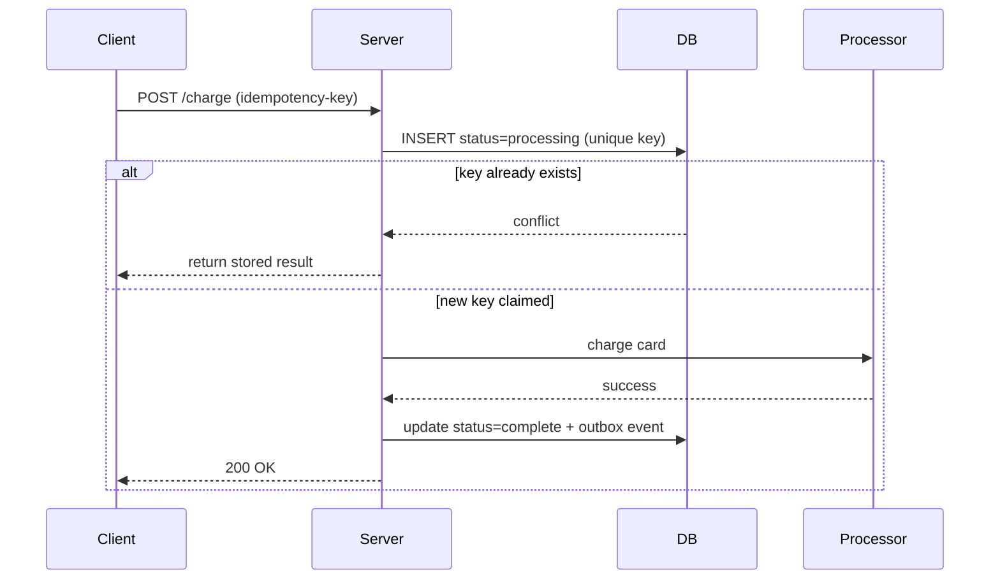
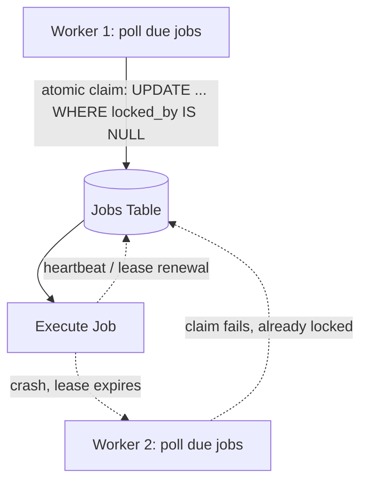
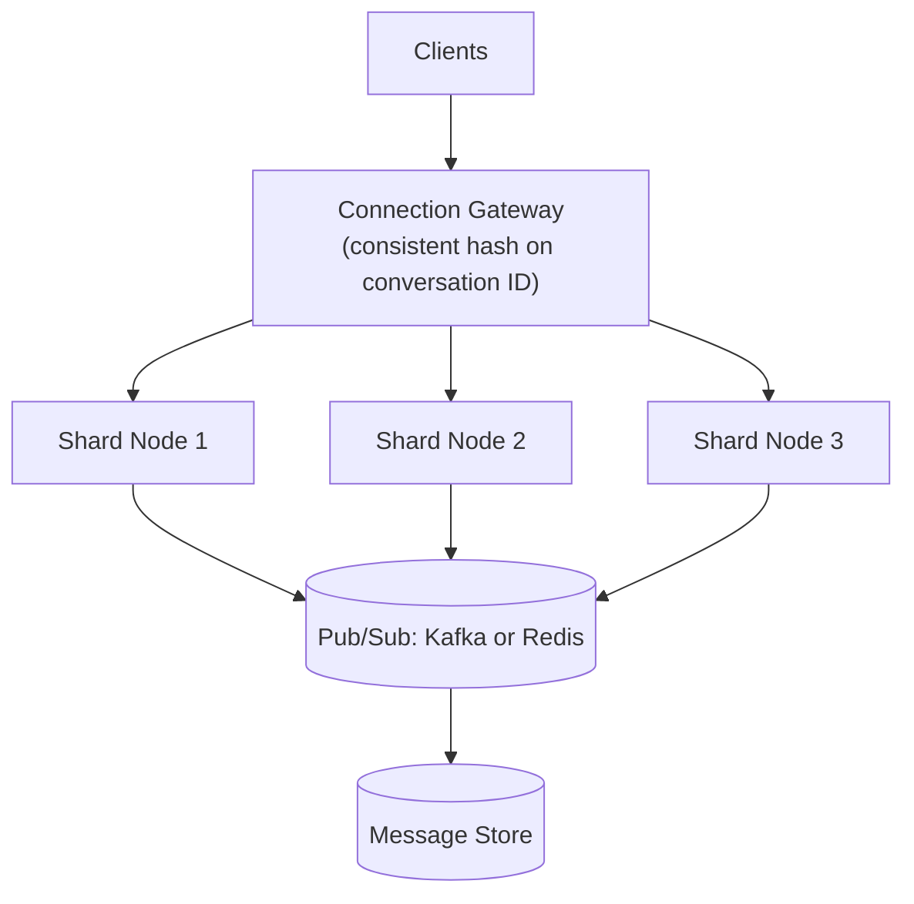
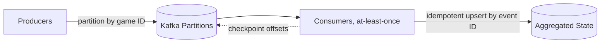
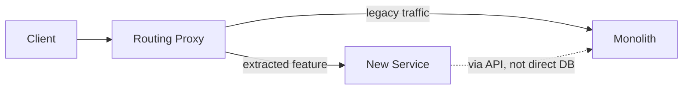
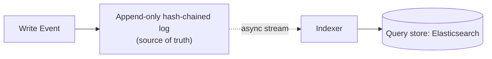

Part 5 of 8 · [Interview Prep](/interview-prep/) · ← Previous: [Part 4 — System Design & Distributed Systems](/interview-prep-system-design/) · Next: [Part 6 — Kafka & Microservices](/interview-prep-kafka-microservices/) →

*Ten designs you should be able to sketch in five minutes. Try drawing each one before you read the answer, because the drawing is what the interview actually asks for.*

**What this assumes:** you've read [Part 4](), or you already know caching, sharding, idempotency, and queues. These case studies use those pieces and link back to them instead of explaining them again.

**What you should be able to do after:** run a 45 minute design round from a blank whiteboard, and say what you'd monitor once it's live.

Every answer opens with **The gist**, one or two plain sentences. If the gist is all you have time for, that's still worth more than a half-remembered detail. The full answer underneath is what you say when they ask you to go deeper.





## The four steps

Someone asking you to design a URL shortener isn't checking whether you've memorized one. They're watching whether you clarify before you build, pick storage you can defend, find the part that's actually hard, and close the loop. Every answer below follows the same four steps, and the steps matter more than any single design.

1. **Clarification.** Say what the system must do (functional), how well it must do it (non-functional, with numbers), and what you're leaving out. Five minutes of "so we don't need analytics or custom domains, right?" saves you from designing the wrong system for the other forty.
2. **High-level design.** The API, the path the data takes, and where it's stored. For each store, say why that one. Keep it small enough to fit on the board.
3. **Deep dive.** There's always one hard part: a bottleneck, a single point of failure, a shard key. Find it, then pick the one component that carries it and explain how it works inside: its data, its steps, what happens when it fails. This is the meat of the round, and it's what they're grading.
4. **Wrap up.** Name what you gave up, then say how you'd know it's healthy: the metrics you'd watch and the alerts you'd page on. Naming the tradeoff yourself is most of the difference between a senior answer and a confident junior one.

**The numbers worth memorizing.** Back-of-envelope maths belongs in step 1, and it rests on about eight facts:

| Fact | Value |
|---|---|
| Seconds in a day | 86,400, round to 100k |
| 1M per day | about 12/sec |
| 100M per day | about 1,200/sec |
| 1B per day | about 12,000/sec |
| 1KB × 1M rows | 1GB |
| 1KB × 1B rows | 1TB |
| Peak vs average traffic | 2x to 3x |
| Read:write ratio, typical web app | 10:1 to 1000:1 |

And roughly what things cost in time, which is what tells you where a latency budget goes:

| Operation | Time |
|---|---|
| Memory read | 100ns |
| SSD random read | 100µs |
| Network round trip, same datacenter | 0.5ms |
| Network round trip, cross-continent | 150ms |

The point of the second table is that one cross-region hop costs more than a thousand SSD reads. Latency problems are almost always about how many network hops you made, not how fast your code is.

---

## Case Studies

### 1. Design a URL shortener. {#1}

{}
**The gist:** a key-value lookup with a redirect on top. Reads outnumber writes by orders of magnitude, so the cache *is* the design.

**1. Clarification**

- **Functional:** shorten a long URL, redirect a short code, expire a link.
- **Non-functional:** 10M new links a day is about 116 writes a second. At a 100:1 read ratio that's 1B redirects a day, near 11,600 reads a second. At roughly 500 bytes a row you write about 4.7GB a day, so 1.7TB a year. Seven base62 characters gives 3.5 trillion codes, which at this rate lasts 965 years. Six gives 56 billion and runs out in 16. So seven, and you can say why.
- **Out of scope:** vanity domains, click analytics, user accounts. Say those out loud so they can pull one back in if they want it.

**2. High-level design**

- **API:** `POST /links` with the long URL returns a short code. `GET /:code` returns a 301 or 302 redirect.
- **Load balancer:** L7, so it can route the write and the read to the same fleet without caring which, since both are stateless HTTP.
- **Code generator:** base62-encode an auto-incrementing ID (alphabet `[0-9a-zA-Z]`, repeatedly divide by 62 and map the remainder to a character), or hash the URL and check for a collision. Base62 is unique for free; a hash needs a read before every write to catch collisions.
- **Cache:** Redis, keyed on `short_code`, value is `long_url`. TTL is long since links rarely change, with LRU eviction so the hot tail of recently-created and frequently-hit links stays resident.
- **Storage:** a primary DB with a read replica. The `links` table is just `short_code` (PK), `long_url`, `created_at`, `expires_at`. It's a plain key lookup with no joins, so any relational or key-value store fits, and Postgres is the boring choice. Reads go to the replica behind the cache; writes go straight to the primary. Replica lag means a link can 404 for a few milliseconds right after creation, which is why a write also seeds the cache directly instead of waiting for the next read to populate it.



**3. Deep dive**

**Component in depth: the ID allocator.**

A counter service hands out ranges, not single IDs. One row holds the next free ID, and an app server claims a block of, say, 10,000 with one atomic statement:

```sql
UPDATE id_counter SET next_id = next_id + 10000 RETURNING next_id - 10000 AS block_start;
```

The server then mints codes from `block_start` upward in memory, with no network call per link. When the block runs out it claims another. Two servers can never get the same block, because the `UPDATE` serializes them.

Before encoding, run the ID through a reversible scramble (multiply by a large odd number modulo 62^7, or XOR with a secret). Codes stop being sequential and stay unique, because the scramble is one-to-one. The cost of this design is gaps: a crashed server throws away the rest of its block. With 3.5 trillion codes, that's free.

- **Single point of failure:** the counter service. A block holds thousands of IDs, so a short outage doesn't stop writes, and a restart just skips the unused rest of a block, which costs nothing.
- **Sharding, later:** 1.7TB a year fits a single primary for a while. When it doesn't, shard on `short_code`, which is already uniformly distributed.

**4. Wrap up**

- **Trade-offs:** the cache is the entire read path. A cold cache after a restart sends 11,600 requests a second straight at the database, so you warm it from the top-N links before taking traffic.
- **Metrics and monitoring:** cache hit ratio (alert when it drops, since the database load follows), redirect p99 latency, 404 rate (a spike means replica lag or scanning), and the counter service's remaining block size.
{}

### 2. Design a distributed rate limiter shared across multiple API gateway instances. {#2}

{}
**The gist:** per-instance counters undercount, because each instance only sees its own share of traffic. The counter has to be shared, and Redis plus one atomic Lua script is the whole answer.

**1. Clarification**

- **Functional:** limit each API client to N requests per window across the whole fleet, and return a 429 with a retry hint.
- **Non-functional:** 50k requests a second across the fleet means 50k counter operations a second, because every request checks. The check must add well under a millisecond. 10M active clients at about 100 bytes of state each is under 1GB, so the working set fits in memory on a single Redis node.
- **Out of scope:** per-endpoint quotas, billing, or fairness between one client's own users.

**2. High-level design**

- **API:** no public one. The gateway calls `allow(client_id)` on every request and gets back yes or no. A no becomes a 429 with a `Retry-After` header.
- **Gateway instances:** stateless by design, so they can't hold the count locally. Each only sees its own slice of the 50k requests a second and would under-count the client's real total.
- **Storage:** one shared Redis holding a counter per client, key format `rate:{client_id}:{window_start}`, with the key's TTL set to the window length so it expires itself instead of needing a cleanup job. Redis fits because the state is tiny, hot, and fine to lose.
- **The Lua script:** what's shown here is a fixed counter that starts at a limit and decrements, not a true token bucket. There's no refill over time, just a hard reset when the key expires and the window rolls over. A real token bucket would restore tokens gradually based on elapsed time, giving smoother throughput than an all-or-nothing reset.

```lua
-- executed atomically via EVAL, keyed per client
local tokens = tonumber(redis.call('GET', KEYS[1]) or ARGV[1])
if tokens > 0 then
  redis.call('DECRBY', KEYS[1], 1)
  return 1 -- allowed
end
return 0 -- rate limited
```



**3. Deep dive**

**Component in depth: the token bucket.**

The Lua script above is a fixed counter. A real token bucket stores two fields per client, `tokens` and `last_refill`, and tops up lazily when a request arrives, so no background job is needed:

```lua
-- KEYS[1]=bucket  ARGV: capacity, refill_per_sec, now_ms
local b = redis.call('HMGET', KEYS[1], 'tokens', 'ts')
local tokens = tonumber(b[1]) or tonumber(ARGV[1])
local ts = tonumber(b[2]) or tonumber(ARGV[3])
tokens = math.min(ARGV[1], tokens + (ARGV[3] - ts) / 1000 * ARGV[2])
local allowed = tokens >= 1
if allowed then tokens = tokens - 1 end
redis.call('HSET', KEYS[1], 'tokens', tokens, 'ts', ARGV[3])
redis.call('PEXPIRE', KEYS[1], 60000)
return allowed and 1 or 0
```

Capacity is the burst a client may spend at once, and the refill rate is the sustained limit. That's why it's smoother than a window: there's no cliff at the boundary where a client sends N requests at 11:59:59 and N more at 12:00:00. Redis runs the script as one atomic step, so two gateways can't both spend the last token. Pass the time in from the caller, or use `redis.call('TIME')`, and don't trust gateway clocks to agree.

- **Single point of failure:** that one Redis node is both your bottleneck and your SPOF, and it's the interesting half of this question. Fail open when it's unreachable and you've removed the limiter during exactly the incident where you need it most. Fail closed and a Redis blip takes down your entire API.
- **Fix:** fail open with a local per-instance fallback limit, so you degrade to approximate limiting rather than none at all.
- **Sharding:** when one node can't take the load, shard by `client_id`. Each client's counter lives on one node, so the atomic script still works.
- **Hot client:** one abusive client is one hot key. Block it at the edge once it's clearly over, so it stops costing you a Redis call per request.

**4. Wrap up**

- **Trade-offs:** every request now pays a network round trip, about 0.5ms in the same AZ. At the p99 that's real money. Teams that can't afford it keep a local token bucket synced periodically, trading exactness for latency.
- **Metrics and monitoring:** Redis latency and CPU, the rate of 429s per client (a sudden jump is either abuse or a bad limit), and how often the fallback path kicks in. Alert on the fallback count, because it means the shared limiter is down.
{}

### 3. Design a real-time fraud scoring system with a tight latency SLA, adding more signals over time. {#3}

{}
**The gist:** run every signal at once with a hard deadline, so you pay for the slowest signal rather than the sum of all of them. Anything too slow gets dropped, not waited for.

**1. Clarification**

- **Functional:** score a transaction as approve, review, or decline, and let new signals be added later without a rewrite.
- **Non-functional:** 5k transactions a second and a p99 budget of 100ms end to end. With 8 signals where the slowest takes 80ms, running them in series is 640ms and you've already blown it. In parallel it's 80ms and you fit. That one comparison is the entire design, which is why the fan-out is the first thing you draw.
- **Out of scope:** training the model, or the human review queue behind it.

**2. High-level design**

- **API:** `POST /score` with the transaction, returns `{verdict, score}`. Synchronous, because the payment is waiting on it.
- **Fan-out orchestrator:** spins up one goroutine per signal, all sharing a single `context.Context` deadline, so a signal that blows past its share of the budget gets cancelled rather than awaited.
- **Signal services:** each computes one feature (device reputation, IP intelligence, velocity) and caches its own result under a key like `signal:device:{device_id}`, with a TTL sized to how fast that signal goes stale: minutes for device reputation, seconds for velocity. Redis fits the cache because every read is a key lookup under a millisecond.
- **Aggregator:** combines whichever signals came back in time into a single score, typically a weighted sum against the model's learned weights, then buckets that score against two thresholds into approve, review, or decline.



**3. Deep dive**

**Component in depth: the fan-out orchestrator.**

It owns the deadline. It creates one context with the whole budget, starts every signal, and collects whatever finishes in time:

```go
ctx, cancel := context.WithTimeout(ctx, 80*time.Millisecond)
defer cancel()

results := make(chan Signal, len(signals)) // buffered: late senders never block
for _, s := range signals {
    go func() {
        v, err := s.Fetch(ctx, txn)
        results <- Signal{Name: s.Name(), Value: v, Missing: err != nil}
    }()
}

got := map[string]Signal{}
for range signals {
    select {
    case r := <-results:
        got[r.Name] = r
    case <-ctx.Done():
        return aggregate(got, signals) // fill the rest as Missing
    }
}
return aggregate(got, signals)
```

Three details matter. The channel is buffered, so a signal that finishes after the deadline can send and exit instead of leaking a blocked goroutine. Every `Fetch` honors `ctx`, so a cancelled call stops doing work. And the orchestrator keeps 20ms for itself: signals get 80ms of the 100ms budget, and the aggregator and network get the rest. Adding a signal means adding one entry to the list, which is how the system grows without a rewrite.

- **Bottleneck:** what a dropped signal does to the score. Silently skipping it means the model sees a different feature set than it was trained on, and the score quietly changes meaning.
- **Fix:** pass an explicit "missing" value the model was trained to handle, and alert on the drop rate, because a signal timing out 30% of the time is a broken signal wearing a working one's name.
- **Single point of failure:** the orchestrator is stateless, so run several behind a load balancer. If the whole scorer is down, decide the default up front: fail open for low-value payments, fail closed for high-value ones.

**4. Wrap up**

- **Trade-offs:** caching signals ahead of the request means scoring on slightly stale data. For device reputation that's fine. For a velocity check, "how many times has this card been used in the last minute," staleness is the whole signal, so that one has to stay live and inside the budget.
- **Metrics and monitoring:** end-to-end p99 against the 100ms budget, per-signal latency and timeout rate, the share of verdicts made with a missing signal, and the approve/review/decline split (a sudden shift means a signal broke or an attack started).
{}

### 4. Design a notification system fanning one event out to millions of users via push, email, and SMS. {#4}

{}
**The gist:** accept the event into a queue immediately, then fan out per user per channel onto separate queues, so a slow SMS provider can't back up your push notifications.

**1. Clarification**

- **Functional:** one event reaches millions of users across push, email and SMS, respecting each channel's rate limits, without duplicate sends.
- **Non-functional:** one event reaching 10M users across 3 channels is 30M individual messages. Push at 10k/sec clears in about 17 minutes. The same 10M over SMS through a provider capped at 100/sec takes 27.8 hours. That number is the design: the channels cannot share a queue, because the slowest one would hold the others hostage for over a day.
- **Out of scope:** preference management, template rendering, unsubscribe handling.

**2. High-level design**

- **API:** `POST /events` with the event type, audience filter and payload. It returns right away with an event ID, because delivery takes minutes to hours.
- **Kafka ingest:** the triggering event lands as a single message, so ingestion cost is constant no matter how many users it'll eventually reach.
- **Fan-out worker:** walks the user list in pages (cursor-based, not offset, so a page boundary doesn't shift underneath a long-running walk), and checkpoints the last cursor per range so a crash resumes instead of restarting from user zero.
- **Per-channel queues:** one message per user per channel, `{user_id, channel, payload, dedupe_key}`, with the dedupe key (a hash of user, event, and channel) letting a worker skip a duplicate it's already sent. Kafka fits because it's durable and each channel can consume at its own pace.
- **Channel worker pools:** each pool runs its own token bucket sized to its provider's actual rate cap, so a slow SMS provider's bucket empties independently of push's, and one channel throttling never blocks another.



**3. Deep dive**

**Component in depth: the fan-out worker.**

It turns one event into millions of messages without ever holding them all. The unit of work is a range of users, not the whole audience:

1. Split the audience into ranges by user ID (say 100k users each) and write one row per range to a `fanout_ranges` table with `event_id`, `start_id`, `end_id`, `cursor`, `status`.
2. A worker claims a range, then loops: read the next page with `WHERE id > cursor ORDER BY id LIMIT 1000`, publish that page's messages to the channel queues, and update `cursor` in the same step.
3. A crash leaves `cursor` at the last finished page. The next worker claims the range and resumes there. At worst one page is re-published, and the dedupe key absorbs it.

Cursor paging matters because offset paging rereads and skips rows when users sign up mid-walk. Ranges matter because they let 50 workers share one event and finish in minutes instead of hours. Publish before you move the cursor: the reverse order loses a page on a crash, and a duplicate is cheaper than a hole.

- **Single point of failure:** "fan out to 10M users" is not one job. If a single worker walks the user list, it starts over from the beginning when it crashes 8M users in.
- **Fix:** split the user list into ranges, hand each range to a worker, and checkpoint progress per range, so a crash resumes instead of restarting.
- **Bottleneck:** the slowest provider. Size each channel's worker pool and token bucket to its provider's real cap, and let that queue run long. A deep SMS queue is fine as long as it's isolated.
- **Sharding:** partition the queues by `user_id`, so a user's messages stay in order and workers don't contend.

**4. Wrap up**

- **Trade-offs:** at-least-once delivery means some users get a duplicate. Deduping on (user, event, channel) at the worker catches most of it, but a crash after the provider call and before the dedupe write will still double-send. The real fix is an idempotency key on the provider API, and not every provider offers one.
- **Metrics and monitoring:** queue depth and age of the oldest message per channel, send rate against each provider's cap, provider error rate, and delivery rate per event. Alert on queue age, not depth, since a deep SMS queue is expected and an old one isn't.
{}

### 5. Design an idempotent payment processing pipeline that survives retries without double-charging. {#5}

{}
**The gist:** the same idempotency key from [Q24](#24), but now wired through the whole pipeline: claim the key, call the processor, store the outcome, and make sure every retry branch has somewhere sensible to land.

**1. Clarification**

- **Functional:** charge a card exactly once even when the client retries, the network drops, or a worker dies mid-call.
- **Non-functional:** 1000 charges a second at peak, against a processor that takes 500ms to 2s. At 2s that's 2000 charges in flight simultaneously, which rules out holding a database transaction open around the processor call. Your connection pool gets sized for the claim and the write, each a few milliseconds, not for the seconds you spend waiting on someone else's API.
- **Out of scope:** refunds, multi-currency, or storing card details.

**2. High-level design**

[Q24](#24) covers the key itself and the `ON CONFLICT DO NOTHING` claim. This question is about what happens around it once a real payment processor is in the loop.

- **API:** `POST /charge` with a client-generated `Idempotency-Key` header. The same key always returns the same answer.
- **Idempotency store:** a `payment_requests` row keyed on `idempotency_key`. In a single database transaction the server claims the key with status `processing`, and the unique constraint means a concurrent duplicate fails immediately. The row is the whole lock, no separate locking system needed. A relational database fits because the claim and the outcome need real transactions.
- **Payment processor call:** made only after the row is claimed, with a short timeout and no automatic retry from this layer, since a retry here is exactly the double-charge risk the key exists to prevent.
- **Outbox:** the same event table and relay from [Q25](#25), reused rather than reinvented, since a completed payment is just another fact that needs to reach downstream systems reliably. On success, update the status and write the outbox event in the same transaction.
- **Reconciliation job:** polls the processor by idempotency key for any row still stuck `processing` past a timeout (a minute or two past the processor's own worst-case latency), and settles the row to whatever the processor actually did.



**3. Deep dive**

**Component in depth: the charge state machine.**

The `payment_requests` row moves through a small set of states, and every transition is a conditional update, so two workers can't both move it:

```
processing --> succeeded
processing --> failed
processing --> unknown   (processor timed out)
unknown    --> succeeded | failed   (reconciliation settles it)
```

```sql
UPDATE payment_requests
SET status = 'succeeded', processor_ref = $2, updated_at = now()
WHERE idempotency_key = $1 AND status IN ('processing', 'unknown');
```

A timeout from the processor is not a failure. It's `unknown`, and nobody retries it. The reconciliation job selects rows in `processing` or `unknown` older than the timeout, asks the processor "what happened to key X?", and applies the matching transition. Because the processor also dedupes on the key, the job may safely re-submit the charge when the processor says it never saw it. The row also stores a hash of the request body, so a client that reuses a key with a different amount gets a 422 instead of someone else's result.

The part worth rehearsing is the branches:

- **Key already claimed and finished.** Return the stored result. No second charge.
- **Key already claimed, still processing.** The first attempt is in flight. Return a 409 or poll, don't start a second charge.
- **Claimed, then the process crashes mid-charge.** The row is stuck in `processing`, and this is the case people forget. You genuinely cannot tell from your own database whether the card was charged. Only the processor knows, so reconcile against it by idempotency key instead of retrying blind.

**Single point of failure:** the database. Run a primary with a synchronous replica, since losing a claim is the one thing this system can't do.

**4. Wrap up**

- **Trade-offs:** a charge is never synchronously certain. The client gets a definite answer on the happy path, and on the crash path it gets "ask again shortly," which the client's own UI has to handle. Systems that promise a synchronous yes or no are lying about the crash case.
- **Metrics and monitoring:** count of rows in `processing` older than the timeout (this should sit at zero, so page on it), processor latency and error rate, duplicate-key hit rate, and the gap between charges at the processor and rows marked complete, checked daily.
{}

### 6. Design a distributed job scheduler where each job runs exactly once even if a node crashes. {#6}

{}
**The gist:** a conditional `UPDATE` is your lock. The one worker whose update actually affects a row owns the job, and a lease makes sure a crashed worker's job comes back.

**1. Clarification**

- **Functional:** run each scheduled job on time, once, surviving worker crashes.
- **Non-functional:** 1M jobs a day averages about 12 a second, which sounds trivial and isn't, because scheduled work clusters. Everything set for midnight fires at midnight, so you size for the spike rather than the mean. With 100 workers polling once a second you're also running 100 mostly-empty queries a second against the jobs table.
- **Out of scope:** job dependencies and DAGs, backfills, or per-job resource isolation.

**2. High-level design**

- **API:** `POST /jobs` to schedule one (`run_at`, `payload`), `GET /jobs/:id` for its status. Workers don't expose an API, they poll.
- **Storage:** a `jobs` table with `id`, `next_run_at`, `locked_by`, `locked_at`, `lease_expires_at`, `status`. Everything a worker needs to decide whether a job is due and free lives in that one row. A relational database fits because the claim needs a transactional compare-and-set, and you get it for free.
- **Polling algorithm:** `SELECT * FROM jobs WHERE next_run_at <= now() AND (locked_by IS NULL OR lease_expires_at < now()) FOR UPDATE SKIP LOCKED LIMIT 1`. `SKIP LOCKED` is what makes concurrent polling cheap: a worker never waits behind another worker's row lock, it just moves to the next candidate.
- **Lease and heartbeat:** the claiming worker renews `lease_expires_at` on an interval well under the lease length (a 30-second lease renewed every 10 seconds, say), so a live worker never loses its own job, and a crashed one's lease simply expires and becomes claimable again.

```sql
UPDATE jobs
SET locked_by = $1, locked_at = now()
WHERE id = $2 AND locked_by IS NULL;

-- 1 row updated means this worker owns the job.
-- 0 rows updated means another worker already claimed it.
```



**3. Deep dive**

**Component in depth: the lease and fencing token.**

A lease alone has a hole: a worker pauses (GC, a slow network), its lease expires, a second worker takes the job, and then the first one wakes up and keeps going. Both now think they own it. The fix is a fencing token, a number that rises on every claim:

```sql
UPDATE jobs
SET locked_by = $1, lease_expires_at = now() + interval '30 seconds',
    attempt = attempt + 1
WHERE id = $2 AND (locked_by IS NULL OR lease_expires_at < now())
RETURNING attempt;
```

The worker keeps the returned `attempt` and sends it with every write it makes: the heartbeat, the completion update, and any side effect that supports it. A write carrying an old `attempt` is rejected (`WHERE id = $1 AND attempt = $2`). The heartbeat runs on its own goroutine and cancels the job's context if a renewal fails, so a worker that loses its lease stops instead of racing the new owner. The fencing token can't undo a side effect that already left your database, which is why the job itself still has to be idempotent.

- **The hard part:** "exactly once" isn't actually achievable, and they want to see whether you know that. A worker can finish a job, then die before marking it done, and the next worker will run it again. There's no way to make the side effect and the bookkeeping atomic when the side effect is outside your database.
- **Fix:** at-least-once execution plus idempotent jobs. Say so plainly.
- **Bottleneck:** the jobs table under polling load. `SKIP LOCKED` or a notify channel beats naive polling well before you think it matters.
- **Single point of failure:** the database. Workers are interchangeable, so losing one costs a lease timeout, not a job.
- **Sharding:** past a few hundred workers, shard jobs by `id` into separate tables or databases so each worker polls one shard.

**4. Wrap up**

- **Trade-offs:** you've made your database a queue. That's a genuinely good choice early, because it's one less system and you get transactions for free, but the polling load and lock contention grow with worker count. Past a few hundred workers you're rebuilding a message broker badly, and should switch to one.
- **Metrics and monitoring:** job lag (`now() - next_run_at` for due jobs, the number to alert on), count of expired leases (each one is a crash or a stall), run duration per job type, and the duplicate-run count if your jobs report it.
{}

### 7. Design a sharded, horizontally-scalable chat backend. {#7}

{}
**The gist:** consistent-hash conversations onto nodes, and put a gateway in front that knows which node owns which conversation. Pub/sub covers anyone who isn't connected to that node.

**1. Clarification**

- **Functional:** 1:1 and group messages, ordered within a conversation, with offline users catching up on reconnect.
- **Non-functional:** 10M daily users and 50M messages a day is 580 a second on average, about 1,700 at a 3x peak. Message throughput is not your problem. Connections are: 1M concurrent WebSockets at roughly 10KB of kernel and application state each is about 500MB per 50k connections, so you need around 20 nodes purely to hold sockets open. Storage at 1KB a message is 47GB a day and 17TB a year.
- **Out of scope:** voice and video, end-to-end encryption, read receipts, or typing indicators.

**2. High-level design**

- **API:** a WebSocket per client for `send` and `receive`, plus `GET /conversations/:id/messages?after=seq` for catch-up on reconnect.
- **Connection gateway:** places both real nodes and conversation IDs on a hash ring, with each real node claiming several points on the ring (virtual nodes) so load spreads evenly instead of piling onto whichever node happens to own a lucky range. See [consistent hashing](#27).
- **Shard nodes:** each holds the live WebSocket connections and in-memory state for the conversations it owns, nothing more, so a node's memory footprint scales with connections, not with total platform history.
- **Pub/sub layer:** one topic per conversation rather than one global topic, so a node only subscribes to the conversations it's actively serving and a burst in one busy group chat doesn't fan out to every node in the cluster.
- **Message store:** `conversation_id`, `seq` (monotonic per conversation), `sender_id`, `body`, `created_at`. The access pattern is always "this conversation, after this seq", so a wide-column store partitioned by `conversation_id` fits well. `seq` is what makes both in-order delivery and offline catch-up possible: a reconnecting client sends its last-seen `seq`, and the node replays everything after it from the store.



**3. Deep dive**

**Component in depth: the message path.**

One send touches four things, and the order is the design:

1. The client sends over its WebSocket to the node that owns the conversation (the gateway routed it there by hashing the conversation ID).
2. The node assigns the next `seq` for that conversation. One owner means a simple in-memory counter, seeded from the highest stored `seq` at startup.
3. The node writes the message to the store, then publishes it to the conversation's topic. Write first: a message that was delivered but never stored is lost the moment a node dies.
4. The node acks the sender with the `seq`, and every node with a member of that conversation pushes it down their sockets.

A client that sees a gap in `seq` (got 41, then 43) knows it missed one and asks `GET /conversations/:id/messages?after=41`. That one rule covers dropped sockets, reconnects, and a new device. If a node dies, the new owner reads the max `seq` from the store before accepting writes, so numbering continues without duplicates. Clients also send a client-generated message ID, so a retried send after a lost ack is recognized instead of stored twice.

- **Single point of failure:** a node holding 50k connections dies. All 50k clients reconnect at once, the gateway rehashes them onto the surviving nodes, and those nodes are now carrying extra load while handling a reconnect storm.
- **Fix:** jittered exponential backoff on the client. Without it you turn one node failure into a rolling cascade, and this is the failure mode that actually takes chat systems down.
- **Sharding:** conversation ID is the shard key. One node owns a conversation, so ordering is trivial.
- **Hotspot:** a single very large group chat can't be split across nodes. At some size those conversations need a different strategy, such as fan-out through the pub/sub layer instead of a single owner.

**4. Wrap up**

- **Trade-offs:** hashing on conversation ID keeps ordering trivial, since one node owns the conversation. It also means that hotspot, and it means a rebalance when nodes join or leave.
- **Metrics and monitoring:** connections per node (the real capacity number), message delivery latency from send to receive, reconnect rate (a spike is a storm starting), pub/sub lag, and the largest conversation's message rate.
{}

### 8. Design a system for ingesting and aggregating high-throughput event streams with the right delivery semantics. {#8}

{}
**The gist:** partition by a natural key so ordering holds per entity, accept at-least-once delivery, and make the aggregation an upsert so a replay can't double-count.

**1. Clarification**

- **Functional:** ingest a high-volume event stream and maintain running aggregates that survive consumer restarts.
- **Non-functional:** 500k events a second at 200 bytes each is about 95MB a second, so 7.9TB a day. A Kafka partition handles roughly 10MB/s comfortably, so that's 10 partitions minimum and you'd provision 50 for headroom and consumer parallelism. Seven days of retention is around 55TB, which is a hardware conversation rather than a config line.
- **Out of scope:** ad-hoc historical queries over raw events, or exactly-once delivery into external systems.

**2. High-level design**

- **API:** producers publish to Kafka (or through a thin ingest endpoint that does). Readers query the aggregate store, for example `GET /games/:id/stats`.
- **Producers:** compute `hash(game_id) % partition_count` per event, so every event for a given entity always lands on the same partition and ordering holds for that entity specifically.
- **Kafka partitions:** sized off the throughput math above (10 minimum, 50 provisioned), since a partition is also the unit of consumer parallelism: more partitions means more consumers can work at once.
- **Consumers:** commit offsets only after the aggregate write succeeds, so a crash between processing and committing replays the same event rather than losing it. That's at-least-once by construction.
- **Aggregated state:** keyed on `event_id` (or `entity_id + window` for a windowed aggregate), with the write shaped as `INSERT ... ON CONFLICT (event_id) DO UPDATE` so a replayed event updates the same row instead of double-counting. A relational or key-value store both fit, as long as the upsert is atomic.



**3. Deep dive**

**Component in depth: the consumer loop.**

The loop's order is what gives you at-least-once without double-counting:

```go
for {
    batch := consumer.Poll(500)              // up to 500 events
    tx := db.Begin()
    for _, e := range batch {
        tx.Exec(`INSERT INTO game_stats (event_id, game_id, points)
                 VALUES ($1, $2, $3)
                 ON CONFLICT (event_id) DO NOTHING`, e.ID, e.GameID, e.Points)
    }
    tx.Commit()
    consumer.CommitOffsets(batch)            // only after the write is durable
}
```

Batching turns 500 round trips into one, which is where most of the throughput comes from. Committing offsets last means a crash between the commit and the offset replays the batch, and `ON CONFLICT DO NOTHING` makes the replay a no-op. Disable auto-commit, or Kafka will commit offsets on a timer, whether or not the write happened. If the aggregate is a sum rather than a set of rows, store the event ID alongside it, or you can't tell a replay from a new event. A poison event that always fails goes to a dead-letter topic after N tries, so one bad message can't stall the partition.

- **The partition key, twice over.** First, whether you picked it deliberately, since ordering only holds within a partition and the key decides what "in order" even means here.
- **Bottleneck, the hot key.** Partitioning by game ID is fine until one game has 100x the traffic of the rest, and that partition's consumer falls behind while the others sit idle. You either split the hot key with a composite key and give up strict per-game ordering, or you accept the lag on that one partition.
- **Single point of failure:** a consumer dying. The group rebalances and another consumer resumes from the last committed offset, so you lose time, not data. Keep Kafka replication at 3 so a broker loss does too.
- **Sharding:** the partition count is your sharding. Pick it high enough up front, since raising it later reshuffles which key lands where.

**4. Wrap up**

- **Trade-offs:** ordering holds inside a partition and nowhere else, so any aggregate spanning multiple keys has no ordering guarantee at all. If the business asks for a globally ordered view later, that's a redesign, not a config change.
- **Metrics and monitoring:** consumer lag per partition (the main alert, and uneven lag points at a hot key), end-to-end latency from produce to aggregate, rebalance count, and broker disk usage against the retention math.
{}

### 9. How would you evolve a monolith into microservices without a risky big-bang rewrite? {#9}

{}
**The gist:** put a proxy in front of the monolith and move one feature at a time behind it. The monolith shrinks instead of getting replaced.

**1. Clarification**

- **Functional:** go from one deployable to several without a rewrite and without a feature freeze.
- **Non-functional:** the number that matters here isn't QPS, it's how long the first extraction takes. Pick a first service you can ship to production within a quarter. If your best candidate needs six months before anything runs for real, it's the wrong candidate, because you'll spend half a year maintaining two systems with nothing to show for it and the appetite will be gone.
- **Out of scope:** changing database technology at the same time, which is how these migrations turn into the rewrite you were avoiding.

**2. High-level design**

- **API:** the public API doesn't change. Clients keep calling the same URLs, and the proxy decides where each one goes.
- **Routing proxy:** a rule table keyed on path or host (`/orders/* → new-service`, everything else → monolith), checked per request, simple enough that adding the next extracted feature is a config change, not a deploy of new routing logic.
- **New service:** calls back into the monolith over its API rather than reading its tables directly, so the monolith's schema stays free to change underneath, which is the whole point of not sharing a database mid-migration.
- **Storage:** the new service gets its own store, picked for its own access pattern. Backfill it from the monolith's historical data, dual-write to both during the transition window so neither copy goes stale, then cut reads over to the new service and stop writing to the monolith's copy.



**3. Deep dive**

**Component in depth: the data cutover.**

Moving the data is a sequence of phases, and you can stop or roll back between any two:

1. **Backfill.** Copy the feature's historical rows from the monolith into the new service's store, and record the point in time you copied up to.
2. **Sync.** Capture changes since that point (change data capture on the monolith's tables, or dual writes from the code) and apply them, so the new store keeps up.
3. **Shadow reads.** The proxy still serves from the monolith, but also calls the new service and compares the answers. Mismatches go to a log. You fix them until the diff is quiet for a week.
4. **Cut reads.** Flip a flag so the new service serves reads. Writes still go to both, so flipping back is instant.
5. **Cut writes.** The new service becomes the owner. The monolith's copy turns read-only, then gets removed after a safe period.

Prefer change data capture over application dual writes when you can. Dual writes can leave the two stores disagreeing when the second write fails, while CDC replays from a log and catches up. Every phase is a flag, not a deploy, which is what makes this boring, and boring is the goal.

- **The hard part:** the database. A service that's been "extracted" but still reads the monolith's tables gives you all the coupling of a distributed monolith and none of the benefits, because you still can't deploy or scale the two independently. The extraction isn't finished until the new service owns its data, and that data migration is usually the expensive part people quietly skip.
- **Dual-write risk:** it only earns its keep because the window is short. Compare the two copies with a reconciliation job before you cut reads over.
- **Single point of failure:** the proxy. Run several, and keep its rules in version control so a bad rule rolls back like code.

**4. Wrap up**

- **Trade-offs:** for the length of the migration you run both systems, with a routing layer and, in places, dual writes. That's more operational surface than you started with, not less, and it stays that way until the last feature moves. Teams that don't finish end up permanently worse off than when they began.
- **Metrics and monitoring:** share of traffic on the new service (your progress bar), error rate and p99 per route, old versus new response diffs during a shadow phase, and mismatches found by the dual-write reconciliation.
{}

### 10. Design a tamper-evident, queryable audit logging system for a fintech platform. {#10}

{}
**The gist:** append-only, and each entry's hash includes the previous entry's hash. Change anything in the past and every link after it breaks, which is what makes tampering visible.

**1. Clarification**

- **Functional:** append-only, tamper-evident, queryable by actor, resource and time range, retained for the regulatory period.
- **Non-functional:** 50M events a day at 1KB each is 47GB a day and 17TB a year. Fintech retention is commonly seven years, so roughly 119TB. That number is why "put it all in Elasticsearch" is the wrong answer: the append-only log belongs in cheap object storage, and only a recent window needs to sit in the query index.
- **Out of scope:** making it tamper-proof, which needs an anchor outside your own infrastructure.

**2. High-level design**

Write audit events to an append-only store, and make tampering detectable by hash-chaining entries. For queryability, stream and index the same events into a separate query-optimized store asynchronously, keeping the append-only log as the source of truth.

- **API:** `POST /audit` to append an event, `GET /audit?actor=&resource=&from=&to=` to query, and `GET /audit/verify` to walk a chain and report the first broken link.
- **Log entry schema:** `seq`, `tenant_id`, `payload`, `prev_hash`, `hash`, `written_at`, matching the struct below with one addition, `tenant_id`, needed once the chain is partitioned per tenant.
- **Indexer:** streams new entries out of the log asynchronously, the same shape as the outbox relay in [Q25](#25) (poll for unindexed rows, index them, mark done), rather than writing to both stores in the request path.
- **Query store:** Elasticsearch, indexed on `actor`, `resource`, and `time range`, the three dimensions an auditor actually filters by. It's search-shaped and rebuildable, so it's fine for it to be the disposable half.

```go
type AuditEntry struct {
    Seq      int64
    Payload  []byte
    PrevHash [32]byte
    Hash     [32]byte
}

func appendEntry(prev AuditEntry, payload []byte) AuditEntry {
    h := sha256.Sum256(append(prev.Hash[:], payload...))
    return AuditEntry{
        Seq:      prev.Seq + 1,
        Payload:  payload,
        PrevHash: prev.Hash,
        Hash:     h,
    }
}

// Altering any past entry changes its Hash, which breaks every
// later entry's PrevHash link. Tampering becomes detectable.
```



**3. Deep dive**

**Component in depth: the chain writer and verifier.**

The writer is the only code allowed to append to a tenant's chain. For each event it reads the tenant's last row, computes the new hash, and inserts with a uniqueness constraint on `(tenant_id, seq)`:

```sql
INSERT INTO audit_log (tenant_id, seq, payload, prev_hash, hash)
VALUES ($1, $2, $3, $4, $5);   -- UNIQUE (tenant_id, seq)
```

If two writers ever race, the constraint rejects the second one, so a fork in the chain is impossible rather than just unlikely. Hash a canonical encoding of the payload (sorted keys, fixed timestamp format), or the same event can hash two ways. Include `tenant_id` and `seq` in the hash input too, so an entry can't be moved to another position or tenant.

The verifier is a separate process with read-only access. It walks a tenant's rows in `seq` order, recomputes each hash from `prev_hash` and the payload, and reports the first row where the recomputed value or the `prev_hash` link doesn't match. Run it on a schedule, and check only rows since the last verified checkpoint so the cost stays flat as the log grows.

- **Single point of failure:** a hash chain needs a strict sequence, and a strict sequence means a single writer. At 580 events a second one writer keeps up fine, but it's a SPOF and it doesn't scale past a point.
- **Sharding:** partition the chain per tenant. Each tenant gets its own sequence and its own writer, so tampering stays detectable within the boundary an auditor actually cares about, one tenant's chain, without forcing every write in the system through one global writer.
- **Failover:** a standby writer takes over a tenant's chain by reading the last stored hash. Use a lease so two writers never extend the same chain.
- **Bottleneck:** the indexer falling behind. The log stays correct, queries just go stale, which is why the index is allowed to lag.

**4. Wrap up**

- **Trade-offs:** hash chaining proves the log is internally consistent. It does not stop someone with write access rebuilding the entire chain from a chosen point forward. To close that, you periodically publish the head hash somewhere you don't control, and that gap is exactly the difference between tamper-evident and tamper-proof. Say it before they ask.
- **Metrics and monitoring:** a scheduled chain verification per tenant (page on any failure), indexer lag, writer failovers, storage growth against the 17TB a year estimate, and the age of the last published head hash.
{}

---

## What to drill first

**[Case Studies](#case-studies):** [1](#1) (URL shortener) is the warm-up, and the right one to run end to end with a timer. [5](#5) (payments) and [6](#6) (job scheduler) are where interviewers go next, because both turn on the crash case. Draw each one on paper before reading the answer, because describing a diagram you can't draw falls apart the moment someone asks a follow-up.

For every case, pick the component in the deep dive and practice explaining it without looking: its state, its steps, and its failure case. That's the part interviewers push on.

Also practice saying step 4 out loud. The tradeoff and the metrics are the two lines most people skip, and they're the two that sound most senior.

---

Part 5 of 8 · [Interview Prep](/interview-prep/) · ← Previous: [Part 4 — System Design & Distributed Systems](/interview-prep-system-design/) · Next: [Part 6 — Kafka & Microservices](/interview-prep-kafka-microservices/) →
