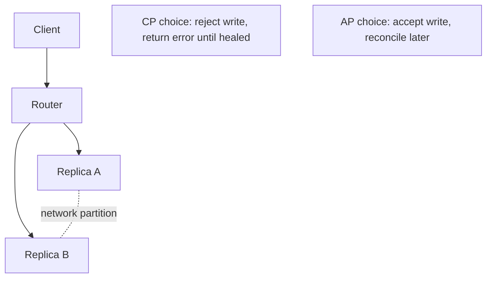
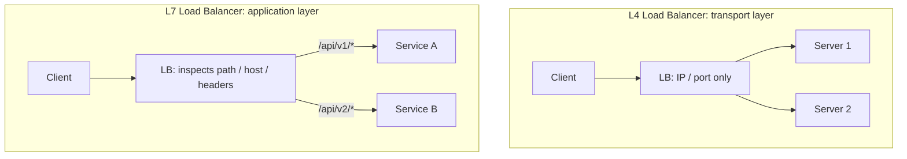
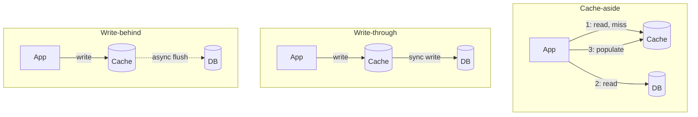
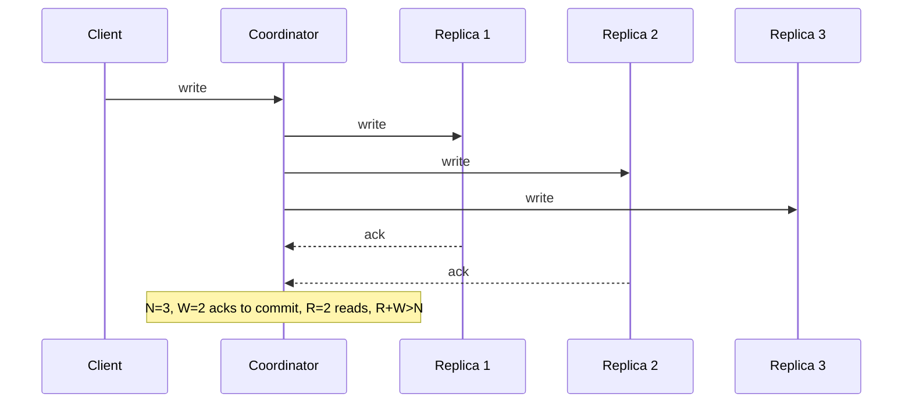
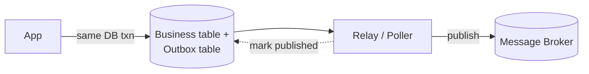
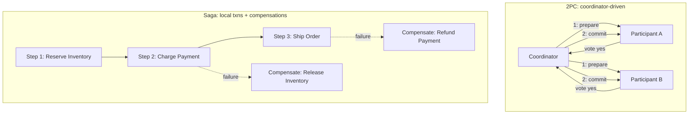
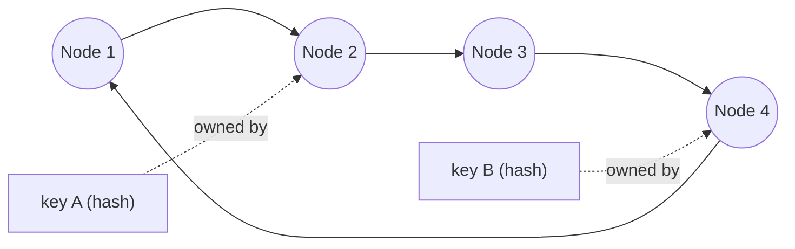
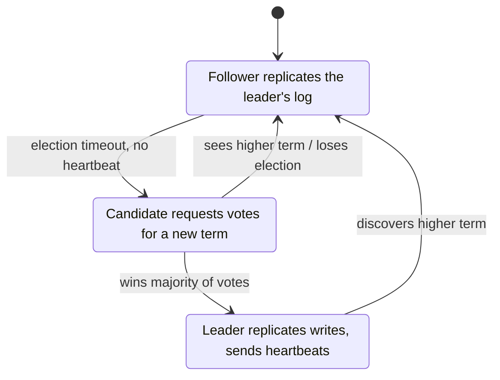
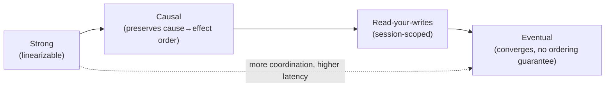
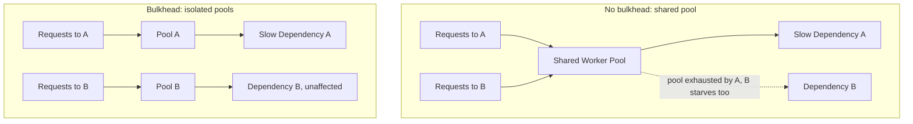

Part 4 of 8 · [Interview Prep](/interview-prep/) · ← Previous: [Part 3 — Databases & SQL](/interview-prep-databases-sql/) · Next: [Part 5 — System Design Case Studies](/interview-prep-system-design-case-studies/) →

System design is the round people dread, and mostly for the wrong reason. It isn't a memory test. It's a test of whether you can say what breaks first and what you'd do about it. These 30 questions build that up from the fundamentals. The full case studies live in [Part 5]().

**What this assumes:** you've written an API that talks to a database, and you know what a query, an index, and an HTTP request are. Sharding, quorums, and Raft all get explained here.

**What you should be able to do after:** sketch a system on a whiteboard and defend the three decisions the interviewer will actually push on.

Every answer opens with **The gist**, one or two plain sentences. If the gist is all you have time for, that's still worth more than a half-remembered detail. The full answer underneath is what you say when they ask you to go deeper.





## Key Concepts: What to Reach For

*Not questions, a map. Skim it to see how the pieces relate, then come back to it later to find the question you need.*

Each row is a concept and the situation that should make you reach for it, so you can orient before drilling into the "why" in the questions. The numbers point to where each one is covered in depth.

**Scaling & data distribution**

| Concept | When to reach for it |
|---|---|
| SQL vs. NoSQL | Choosing the storage model itself, before sharding or caching even enter the picture ([Q11](#11), [Q12](#12)). |
| Horizontal scaling | You've hit a ceiling on one box and the workload is stateless enough to split across many ([Q1](#1)). |
| Sharding / horizontal partitioning | A single database's write throughput or storage has become the bottleneck ([Q3](#3)). |
| Consistent hashing | Nodes get added and removed, and you need only a fraction of keys to remap rather than almost all of them ([Q27](#27)). |
| Caching: cache-aside / write-through / write-behind | Reads vastly outnumber writes and some staleness is tolerable. Pick the variant by how fresh reads need to be versus how fast writes need to be ([Q10](#10)). |
| L4 vs. L7 load balancing | L4 when you just need fast, protocol-agnostic distribution; L7 when routing needs to look at path, host, or cookies ([Q9](#9)). |

**Consistency & coordination**

| Concept | When to reach for it |
|---|---|
| CAP theorem | Framing any "what happens during a network partition" design decision ([Q8](#8)). |
| PACELC | Same question, but you also need to reason about the latency/consistency trade-off when there's *no* partition ([Q22](#22)). |
| Consistency spectrum (strong / causal / read-your-writes / eventual) | Picking the cheapest guarantee that's still correct for the feature: a like count needs less than a balance check ([Q2](#2), [Q29](#29)). |
| Quorum reads/writes (N/R/W) | You're replicating across N nodes and want a tunable guarantee that reads see the latest write ([Q23](#23)). |
| Distributed locks | Coordinating mutual exclusion across processes, not just goroutines in one process ([Q13](#13)). |
| Leader election / Raft | A cluster of nodes needs to agree on exactly one coordinator, and that agreement must survive crashes ([Q14](#14), [Q28](#28)). |
| Clock skew / logical clocks | You need to order events across machines and wall-clock timestamps aren't reliable enough ([Q16](#16)). |

**Messaging & delivery**

| Concept | When to reach for it |
|---|---|
| Sync vs. async communication | Sync when you need an immediate answer and can accept coupling to the callee's availability; async when you can decouple in time ([Q6](#6)). |
| Backpressure | A fast producer would otherwise overwhelm a slow consumer's buffer ([Q7](#7)). |
| Idempotency & idempotency keys | A client might retry a request and you need retries to be safe ([Q5](#5), [Q24](#24)). |
| Delivery semantics (at-most / at-least / exactly-once) | Deciding what a message queue actually guarantees you, and what your own code still has to guarantee on top ([Q15](#15)). |
| Outbox pattern | You need a DB write and a message publish to succeed or fail together ([Q25](#25)). |
| Saga vs. two-phase commit | A transaction spans multiple services and holding locks across all of them (2PC) is too heavyweight ([Q26](#26)). |
| Kafka vs. RabbitMQ vs. NATS | Kafka for a durable, replayable event log; RabbitMQ for flexible routing and per-message ack/retry; NATS for low-latency, lightweight pub/sub ([Q4](#4)). |
| Gossip protocols | Detecting node failure across a large cluster without a central bottleneck ([Q21](#21)). |

**Resilience & failure handling**

| Concept | When to reach for it |
|---|---|
| Thundering herd mitigation (jitter, coalescing) | Many clients would otherwise retry or wake up at the same instant against a recovering resource ([Q17](#17)). |
| Bulkhead vs. circuit breaker | Bulkhead to stop one dependency's failure from starving resources shared with everything else; circuit breaker to stop calling a dependency that's clearly already failing ([Q30](#30)). |
| Byzantine vs. crash fault tolerance | Byzantine only matters in adversarial or untrusted settings; infrastructure you control just needs crash-fault tolerance (Raft/Paxos) ([Q18](#18)). |
| Two Generals' Problem | Reasoning about why perfect agreement over an unreliable channel is impossible, and why we settle for retries plus idempotency instead ([Q19](#19)). |
| CRDTs | Replicas need to accept writes independently (offline-first, multi-region) and eventual convergence is good enough ([Q20](#20)). |

**Applied patterns (case studies in Part 5)**

| Pattern | Use case it solves |
|---|---|
| Read-heavy key lookup + cache in front of DB | URL shortener ([Q1](#1)). |
| Shared atomic counter (Redis + Lua) | Rate limiting across multiple gateway instances ([Q2](#2)). |
| Bounded parallel fan-out with a deadline | Aggregating many signals under a tight latency SLA ([Q3](#3)). |
| Queue-based fan-out per channel | Notifying millions of users across push/email/SMS ([Q4](#4)). |
| Idempotency key + unique constraint | Payment processing that survives retries without double-charging ([Q5](#5)). |
| Atomic claim + lease/heartbeat | A job scheduler where each job runs exactly once, even across crashes ([Q6](#6)). |
| Consistent hashing + pub/sub | A sharded, horizontally-scalable chat backend ([Q7](#7)). |
| Partition by natural key + idempotent upsert | High-throughput event ingestion without double-counting on reprocess ([Q8](#8)). |
| Strangler fig | Migrating a monolith to microservices incrementally, without a big-bang rewrite ([Q9](#9)). |
| Hash-chained append-only log | Tamper-evident, queryable audit logging ([Q10](#10)). |

---

## System Design Fundamentals

*1 to 7 are vocabulary you'll use in every design conversation. 8 to 10 are the ones you should be able to draw from memory. 11 and 12 are the decision that comes before any of it: what kind of database this even is.*

### 1. Difference between vertical and horizontal scaling, and when does horizontal stop being trivial? {#1}

{}
**The gist:** vertical is a bigger machine, horizontal is more machines. Horizontal is easy right up until state enters the picture, and then state is the whole problem.

Vertical scaling means a bigger machine: simple, but it has a hard ceiling. Horizontal scaling means more machines sharing load, and it stops being trivial the moment state enters the picture. Stateless request handling scales linearly, but a stateful component needs partitioning, replication, or coordination logic.
{}

### 2. Explain eventual consistency with a good-fit and bad-fit example. {#2}

{}
**The gist:** replicas agree eventually, not instantly. Fine for a like count, dangerous for a balance check right before a withdrawal.

Eventual consistency means replicas will converge given enough time without new writes, but reads shortly after a write might see stale data.

Good fit: a like count. Bad fit: an account balance check right before authorizing a large withdrawal.
{}

### 3. Difference between horizontal and vertical partitioning (sharding) of a database? {#3}

{}
**The gist:** vertical splits a table by columns, horizontal (sharding) splits it by rows across machines. Same word, two completely different problems.

Vertical partitioning splits a table by columns: same rows, different tables. Horizontal partitioning (sharding) splits a table by rows across multiple database instances based on a shard key, so each shard holds a subset of rows but the full schema.

**What they're testing:** whether you keep the two straight under pressure. Part 3 covers [partitioning versus sharding](#28) from the single-instance side, and interviewers like asking both.
{}

### 4. When would you choose Kafka vs RabbitMQ vs NATS? {#4}

{}
**The gist:** Kafka is a replayable log, RabbitMQ is a smart work queue, NATS is fast and light. Pick by whether you need history, routing, or raw speed.

**Kafka:** high-throughput, durable, replayable event log, ideal for event sourcing and stream processing. **RabbitMQ:** flexible routing, strong work-queue semantics with per-message ack and retry. **NATS:** extremely low latency, lightweight pub/sub.
{}

### 5. Explain idempotency and why it matters in distributed systems. {#5}

{}
**The gist:** doing it twice gives the same result as doing it once. You need it because a client whose request times out genuinely can't tell whether it worked.

An idempotent operation produces the same end result no matter how many times it's applied. That's critical because network failures mean clients can't always tell if a request succeeded, so they have to be able to retry safely.

**What they're testing:** whether you connect it to retries. Idempotency isn't a nice property in the abstract, it's what makes a retry safe, and retries are unavoidable.
{}

### 6. Synchronous vs asynchronous communication between services: what are the tradeoffs? {#6}

{}
**The gist:** sync gives you an answer now and ties your uptime to theirs. Async decouples you, and hands you retries, ordering, and eventual consistency to deal with instead.

Synchronous is simpler and gives immediate feedback, but it couples the caller's availability to the callee's. Asynchronous decouples services in time, at the cost of eventual consistency and more complex failure, retry, and ordering handling.
{}

### 7. Explain backpressure and why a fast producer plus a slow consumer needs it. {#7}

{}
**The gist:** a way for a slow consumer to say "slow down" instead of silently buffering until something runs out of memory.

Backpressure is a mechanism for a slow consumer to signal a fast producer to slow down, preventing unbounded buffering that leads to memory exhaustion or unbounded latency growth.

```go
// A bounded channel is backpressure. Once 100 items are queued,
// the producer blocks on send until the consumer catches up.
jobs := make(chan Job, 100)

// Unbounded would be make(chan Job) fed by an ever-growing slice:
// the producer never blocks, and memory grows until the process dies.
```

**Try it:** run the bounded-channel snippet with a producer faster than the consumer, and watch `len(jobs)` climb to the buffer size and stay there instead of growing without bound.
{}

### 8. Explain CAP theorem with a concrete example. {#8}

{}
**The gist:** when the network splits, you pick one: keep answering with possibly-stale data, or refuse to answer rather than risk being wrong. You don't get both.

Under a network partition, a distributed system must choose between Consistency (every read sees the latest write) and Availability (every request gets a response, even if possibly stale).

Choosing AP: a shopping cart service that keeps accepting writes during a partition and reconciles later. Choosing CP: a bank ledger balance check that would rather return an error than risk showing a stale balance.



**What they're testing:** that you know "CA" isn't a real option. Partitions aren't a design choice, they're weather, so the only question is what you do when one happens.
{}

### 9. Explain L4 vs L7 load balancing. {#9}

{}
**The gist:** L4 forwards packets by IP and port without opening them. L7 reads the HTTP request and can route on path or host. Speed versus smarts.

L4 (transport layer) balances based on IP, port, and TCP/UDP-level info without inspecting request content, which makes it fast and protocol-agnostic. L7 (application layer) understands HTTP and can route based on path, host header, or cookies: more flexible, but it adds processing overhead.


{}

### 10. Explain caching strategies: cache-aside, write-through, write-behind. {#10}

{}
**The gist:** three answers to "when does the database get the write?" Cache-aside fills on a miss, write-through writes both at once, write-behind writes later and hopes nothing crashes.

**Cache-aside:** the app checks the cache first, and on a miss reads from the database and populates the cache. **Write-through:** writes go to the cache and database synchronously together, so reads are always fresh but writes are slower. **Write-behind:** writes go to the cache immediately and are asynchronously flushed to the database later, which is fastest for writes but risks data loss if the cache fails before flushing.



**Try it:** implement cache-aside against `redis-cli`: `GET` a key, on a miss read from your database and `SETEX` it with a short TTL, then `GET` it again and confirm the second read never touches the database.
{}

### 11. SQL vs. NoSQL: what's actually different, and when would you choose each? {#11}

{}
**The gist:** SQL enforces a schema up front and gives you joins plus multi-row ACID transactions. NoSQL relaxes some of that on purpose, in exchange for horizontal scale and a data model that's cheap to change.

A relational (SQL) database enforces a schema before you write anything, supports arbitrary joins across normalized tables, and gives strong ACID transactions across multiple rows and tables at once. That structure is also the constraint: scaling writes horizontally means sharding, and sharding is what breaks the cross-shard joins and transactions the model was built around.

A NoSQL database relaxes one or more of those guarantees deliberately, usually the schema, the joins, or the multi-row transaction, to get horizontal scalability and a data model that's cheaper to change as the product changes. Most trade toward BASE (Basically Available, Soft state, Eventually consistent) instead of ACID, the same trade [Q2](#2) covers from the consistency side.

Choose SQL when the data has real relationships you'll query across, and correctness under concurrent writes matters more than raw write throughput: orders, payments, inventory. Choose NoSQL when the access pattern is simple and known ahead of time (fetch by key, append an event), the schema keeps changing, or a single relational instance can't hold the write volume or connection count.

**What they're testing:** whether "NoSQL is for scale" is the whole answer you have, or whether you'll also say what you give up to get it. Plenty of NoSQL migrations get quietly undone once someone needs a join that used to be free.

**Try it:** take one table from a project you know well and write down every join it currently makes. Each one becomes application-code work, or duplicated data to avoid it, the moment that table moves to a non-relational store.
{}

### 12. What are the main types of NoSQL databases, and what does each one actually fit? {#12}

{}
**The gist:** "NoSQL" isn't one data model, it's four unrelated ones that all happen to skip a fixed relational schema. The type decides what it's good at, not the "NoSQL" label.

**Key-value** (Redis, DynamoDB in its simplest mode): a hash map with a network in front of it. Fast and simple, and only good for lookups by a known key: sessions, caches, feature flags.

**Document** (MongoDB): stores semi-structured JSON-like documents, each one self-contained. Fits data that's naturally a single nested object, read and written as a whole, whose shape varies row to row: a product catalog, a user profile.

**Wide-column** (Cassandra, Bigtable): a row can have millions of columns, and each row is looked up by a partition key you choose deliberately, since that key decides which node holds the row. Fits huge write volume with a small, predictable set of query patterns: time-series data, event logs.

**Graph** (Neo4j): stores nodes and the relationships between them as first-class citizens, so a query that would be a five-table join in SQL, "friends of friends who also like X," is a single traversal. Fits data where the relationships matter more than the entities: social graphs, fraud rings, recommendation engines.

```
Key-value:   {key -> value}                     lookup by key only
Document:    {_id: 1, name: "x", tags: [...]}   lookup + query within a document
Wide-column: (partition key, columns...)        huge write volume, known query shape
Graph:       (node)-[relationship]->(node)      relationships are the query
```

**What they're testing:** whether you pick the type from the access pattern, not the brand name. "We use MongoDB" doesn't answer "why document over wide-column," and that follow-up is the real question.

**Try it:** take a feature you've built that used a relational table, and work out which of the four types, if any, actually fits its real query pattern better, and specifically why: does that query need a join, a range scan on a partition key, or a graph traversal?
{}

---

## Distributed Systems Concepts

*The deep end, and nobody expects a junior to have all eighteen. But 15, 17 and 24 show up in ordinary backend work long before anyone calls it distributed systems, so start there.*

### 13. Explain a distributed lock, and why plain mutexes don't work across services. {#13}

{}
**The gist:** a mutex only coordinates goroutines inside one process. Once two servers need to agree, the lock has to live somewhere they can both see, with a TTL so a crash doesn't wedge it forever.

A `sync.Mutex` only coordinates goroutines within a single process's memory space. A distributed lock uses a shared external system (Redis Redlock, or etcd and Zookeeper with consensus-backed leases) so multiple independent processes can agree on mutual exclusion, typically with a lease or TTL.

**Try it:** acquire a lock with `SET lock:job1 owner NX EX 10` in `redis-cli` from two terminals. Only one returns `OK`; the other gets `nil` and knows to back off.
{}

### 14. What's leader election, and how does it typically work? {#14}

{}
**The gist:** getting a group of nodes to agree on exactly one boss, and to pick a new one quickly when that boss dies.

It's a mechanism for a group of distributed nodes to agree on exactly one leader. Typically it's implemented via a consensus protocol like Raft: nodes propose themselves, a majority quorum must agree, and if the leader fails to renew its lease, a new election triggers.
{}

### 15. At-most-once vs at-least-once vs exactly-once delivery, and why is exactly-once mostly a myth? {#15}

{}
**The gist:** at-most-once can lose messages, at-least-once can repeat them, exactly-once is mostly marketing. You get the effect of exactly-once by making repeats harmless.

At-most-once means a message might be lost. At-least-once means it's guaranteed delivered, but possibly more than once. Exactly-once is extremely hard end to end. In practice, systems achieve "effectively exactly-once" by combining at-least-once delivery with idempotent processing.

**What they're testing:** whether you push back on the phrase. A broker that advertises exactly-once is describing its own hop, not your handler, and your handler still has to be idempotent.
{}

### 16. How do clock skew and distributed time affect ordering of events across services? {#16}

{}
**The gist:** two machines' clocks disagree, so you can't order events by comparing timestamps. Use logical clocks, or one thing that hands out the order.

Wall-clock timestamps from different machines aren't reliably comparable, because of clock drift. The solutions are logical clocks (Lamport or vector clocks) that capture causal ordering, or a centralized sequencer or monotonic ID source when a single global order is genuinely required.
{}

### 17. What is the thundering herd problem, and how do jitter and coalescing prevent it? {#17}

{}
**The gist:** everyone retries at the same instant and re-kills the thing that just came back up. Jitter spreads them out, coalescing makes many callers share a single request.

Thundering herd is when a large number of clients wake up or retry simultaneously, overwhelming a resource that was just recovering.

Jittered backoff randomizes retry timing. Request coalescing (single-flight) makes sure only one actual request goes to the backend when many callers want the same resource.

**What they're testing:** whether you'd catch it in your own retry code. Plain exponential backoff without jitter still synchronizes every client on the same schedule, which is the trap.

**Try it:** wrap a cache-refill call in Go's `singleflight.Group`, fire 50 concurrent goroutines requesting the same key on a miss, and confirm only one of them actually reaches the database.
{}

### 18. What's the difference between Byzantine and crash-fault tolerance, and why do Raft and Paxos only handle the latter? {#18}

{}
**The gist:** crash faults mean a node goes silent. Byzantine means it lies. Raft handles silence, and silence is all you need for servers you own.

Crash-fault tolerance assumes a failed node simply stops responding, so it never lies. Byzantine fault tolerance assumes a node can behave arbitrarily: send conflicting messages to different peers, claim false state, or act maliciously.

Raft and Paxos only tolerate crash faults, which is why they're safe for trusted infrastructure you control (your own replica set) but insufficient for adversarial settings like blockchain consensus, which need BFT protocols such as PBFT or Tendermint instead.
{}

### 19. What is the Two Generals' Problem, and what does it actually prove about distributed consensus? {#19}

{}
**The gist:** you can never be certain your last message arrived, no matter how many acknowledgements you trade. So real systems stop chasing certainty and use retries plus idempotency.

Two armies must attack a city simultaneously to win, but can only coordinate via messengers who might be captured, which stands in for messages that might be lost. No matter how many acknowledgments are exchanged, neither general can ever be 100% certain the other received the final ACK, so perfect agreement over an unreliable channel is provably impossible.

In practice, systems don't solve this. They work around it with retries, timeouts, and idempotency, accepting a vanishingly small but nonzero risk instead of a mathematical guarantee.
{}

### 20. What is a CRDT, and when would you reach for one instead of a distributed lock? {#20}

{}
**The gist:** a data structure built so concurrent edits always merge to the same answer, with no coordination. Great for offline-first apps, useless for "balance never goes negative."

A Conflict-free Replicated Data Type is a data structure (counter, set, map) designed so that concurrent updates from different replicas can always be merged deterministically into the same final state, without coordination or locking. A grow-only counter that merges by taking the max per-replica count is the standard example.

Reach for one when replicas need to accept writes independently (offline-first apps, multi-region writes) and eventual convergence is good enough. Skip it when you need a strict invariant a CRDT can't express, like "balance never goes negative."

**Try it:** implement a grow-only counter as a map of replica ID to count, merge two replicas' maps by taking the max per key, and confirm the result is the same no matter which order you merge them in.
{}

### 21. How does a gossip protocol detect node failure, and how does that differ from a centralized health check? {#21}

{}
**The gist:** each node pings a few random peers and passes on what it heard. Failure news spreads like a rumour, with no central health checker to fall over.

Each node periodically pings a few random peers and forwards what it's heard about others' health, so failure information spreads epidemic-style across the cluster in O(log N) rounds, without a central bottleneck or single point of failure.

A centralized health-check registry is simpler to reason about, but it doesn't scale as well and becomes a single point of failure itself. Gossip (for example SWIM) trades a small amount of detection latency for horizontal scalability and resilience.
{}

### 22. What does PACELC add to CAP theorem? {#22}

{}
**The gist:** CAP only covers what happens during a partition. PACELC adds the other 99.9% of the time, when you're still trading latency against consistency.

CAP only describes the tradeoff during a network partition (P). PACELC extends it: if Partitioned, choose Availability or Consistency, as in CAP. Else, even with no partition at all, choose Latency or Consistency, since synchronously confirming a write across replicas for strong consistency always costs latency versus acknowledging locally and replicating asynchronously.

It's a more complete lens for classifying real systems. DynamoDB is PA/EL, while a synchronously-replicated SQL cluster is PC/EC.

**What they're testing:** whether you notice that CAP describes a rare event. Most of your latency budget is spent in the "else" branch, which is the half CAP says nothing about.
{}

### 23. Explain quorum-based consistency (N/R/W). {#23}

{}
**The gist:** write to W replicas, read from R, and if R + W is greater than N your read is guaranteed to touch at least one replica holding the newest write.

N is the total number of replicas. W is how many replicas must acknowledge a write before it's considered successful. R is how many replicas a read must query and reconcile before returning a result. If `R + W > N`, every read is guaranteed to overlap with the most recent write's replica set.


{}

### 24. How would you design idempotency keys for a payment API? {#24}

{}
**The gist:** the client sends a unique key with the request. The server claims that key atomically before charging anything, so a retry finds the existing claim and replays the old answer instead of charging twice.

Require the client to generate a unique idempotency key per logical operation and send it in the request header. The server checks a store keyed on that idempotency key: if it's been seen before, return the previously stored result; if not, atomically claim the key before doing the actual charge.

```sql
INSERT INTO payment_requests (idempotency_key, status)
VALUES ($1, 'processing')
ON CONFLICT (idempotency_key) DO NOTHING;

-- 0 rows affected means a request with this key is already in
-- flight or finished. Look up and return its stored result
-- instead of charging again.
```

The unique constraint is doing the real work here. Two concurrent retries both run this statement, and exactly one of them gets a row back.

**What they're testing:** that the claim happens *before* the charge. Claiming afterwards leaves a window where a retry lands mid-charge, which is the bug this whole design exists to prevent. [Q5](#5) in Part 5 walks the same idea through a full pipeline.

**Try it:** run the `INSERT ... ON CONFLICT DO NOTHING` statement above twice with the same key from two separate terminals at roughly the same time, and confirm only one reports a row inserted.
{}

### 25. Explain the outbox pattern for reliably publishing events after a DB write. {#25}

{}
**The gist:** you can't write to the database and publish to a broker atomically. So write the event into the same database in the same transaction, and let a separate relay publish it afterwards.

Instead of writing to the database and then separately publishing to a message broker (which can fail independently), you write the business change and an outbox event row in the *same* database transaction. A separate poller or relay process reads unpublished outbox rows, publishes them, and marks them sent.

```go
tx, _ := db.BeginTx(ctx, nil)
tx.Exec(`UPDATE accounts SET balance = balance - $1 WHERE id = $2`,
    amount, from)
tx.Exec(`INSERT INTO outbox (event_type, payload, published)
         VALUES ($1, $2, false)`, "FundsDebited", payload)
tx.Commit() // business change + outbox row commit atomically

// separate relay process:
// SELECT * FROM outbox WHERE published = false
// -> publish to broker -> mark published = true
```



**What they're testing:** whether you can name the dual-write problem. Two writes to two systems can't both be guaranteed, so the trick is to make it one write and move the second one downstream.

**Try it:** insert a business row and an outbox row in one transaction, then run the relay's `SELECT * FROM outbox WHERE published = false` by hand and confirm your new event is sitting there waiting to be published.
{}

### 26. What is a saga pattern, and when would you use it instead of 2PC? {#26}

{}
**The gist:** split the distributed transaction into local steps, each with an undo step. Harder to reason about than 2PC, but nobody holds locks across services while a human approves something.

A saga breaks a distributed transaction into a sequence of local transactions, each with a compensating action to undo it if a later step fails, instead of holding locks across services the way two-phase commit does.


{}

### 27. Explain consistent hashing and why it's used for sharding and caching. {#27}

{}
**The gist:** put nodes and keys on a ring, so adding a node only moves the keys sitting next to it. Plain `hash % N` moves almost every key the moment N changes.

Consistent hashing maps both nodes and keys onto a hash ring, and a key is owned by the next node clockwise on the ring. When a node is added or removed, only the keys between it and its neighbor need to move. With naive `hash(key) % N` sharding, changing N remaps almost every key, which means a cache that's suddenly all misses.



**Try it:** hash 10 keys against `hash(key) % 4` and again against `% 5`, and count how many land on a different node. Then put the same 4 nodes on a ring and add a fifth: far fewer keys move.
{}

### 28. Walk through Raft leader election and log replication in more depth. {#28}

{}
**The gist:** nodes vote for a leader each term, the leader replicates writes, and an entry only counts as committed once a majority has stored it. That majority rule is what makes committed writes survive any single crash.

Every node is a Follower, Candidate, or Leader, and time is divided into monotonically increasing terms. A Follower that hears no heartbeat before its election timeout becomes a Candidate, increments the term, and requests votes. It becomes Leader on receiving votes from a majority.

The Leader then replicates every write as a log entry to followers. An entry is only committed (safe to apply) once a majority of nodes have persisted it, and the Leader tracks a commit index that only advances forward.

If a Leader crashes mid-replication, the next elected Leader is guaranteed to already have every committed entry, because of the election rule that a node only votes for candidates with an equally or more up-to-date log. So no committed write is ever lost.



**What they're testing:** the follow-up, which is always "what happens if the leader crashes mid-write." The answer is the election restriction: a candidate missing committed entries can't win a majority.
{}

### 29. Where do strong, causal, and eventual consistency sit relative to each other, and what is "read-your-writes"? {#29}

{}
**The gist:** strong means every read sees the newest write and costs the most. Eventual costs the least and may hand you stale data. Causal and read-your-writes are the useful middle ground.

**Strong consistency:** every read sees the latest committed write, as if there were only one copy of the data. Most expensive, since it needs coordination on every read or write.

**Eventual consistency:** replicas converge given enough time with no new writes, but a read shortly after a write can return stale data. Cheapest, no coordination needed.

**Causal consistency** sits between them: operations that are causally related (a reply to a comment) are seen by everyone in that order, but unrelated operations can be seen in different orders on different replicas.

**Read-your-writes** is a narrower, practical guarantee often layered on top of eventual consistency. A specific client is guaranteed to see its own writes on its next read, for example by routing that client's reads to the replica it wrote to, or via a sticky session, even if other clients might still see stale data.


{}

### 30. Explain the bulkhead pattern, and how it differs from a circuit breaker. {#30}

{}
**The gist:** a circuit breaker stops you calling something that's already broken. A bulkhead stops that broken thing from eating the resources everything else needs.

A [circuit breaker](#36) protects a single dependency by stopping calls to it once it's clearly failing. A bulkhead protects everything else from that one dependency by isolating resources: a separate connection pool, goroutine pool, or thread pool per downstream, so a slow or exhausted dependency can only exhaust its own pool rather than starving requests to unrelated services in the same process.

The two compose. Bulkheads limit blast radius, and circuit breakers stop wasting the limited resources bulkheads gave that dependency on calls likely to fail anyway.



**What they're testing:** whether you see them as complementary rather than alternatives. Answering "a bulkhead instead of a circuit breaker" is the wrong shape, you want both.

**Try it:** create two separate bounded worker pools in Go, saturate one with slow fake calls, and confirm requests to the other pool still complete on time.
{}

---

## What to drill first

**[System Design Fundamentals](#system-design-fundamentals):** [5](#5) (idempotency) turns up in ordinary backend work every week, long before anyone asks you to design a distributed system. Practice actually drawing [8](#8) through [10](#10) from memory, not just describing them out loud. CAP and the three caching strategies are the two most likely to become a whiteboard request. [11](#11) (SQL vs. NoSQL) is worth having an opinion on too, since most system design rounds ask you to pick a database before anything else.

**[Distributed Systems Concepts](#distributed-systems-concepts):** [28](#28) (Raft), [29](#29) (the consistency spectrum), and [30](#30) (bulkhead) are the ones most likely to turn into a follow-up "ok, now what if the leader crashes mid-write" question, so have those diagrams reflexive, not just recitable. [16](#16), [17](#17), and [23](#23) through [27](#27) are worth sketching too.

**System Design Case Studies:** they have their own part now. Start with [Part 5](), and draw each design on paper before reading the answer.

---

Part 4 of 8 · [Interview Prep](/interview-prep/) · ← Previous: [Part 3 — Databases & SQL](/interview-prep-databases-sql/) · Next: [Part 5 — System Design Case Studies](/interview-prep-system-design-case-studies/) →
