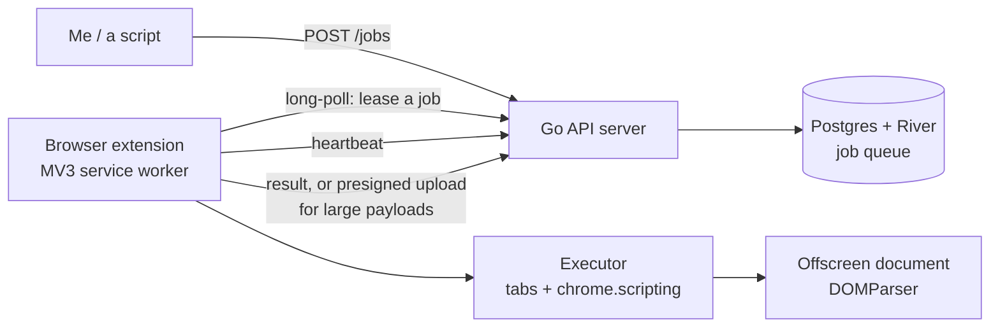

I still hate paying for scraping, and I keep coming back to the same idea.

It showed up again last month while I was pricing APIs for a few small automations. The plans that do what I want cost more per month than most of my side projects, and plenty of sites don't offer an API at all. That's the same feeling that started [Scrapeit](): I'm paying for infrastructure to do something my own browser does for free. My rule hasn't changed: **when scraping can be free, it should be free.**

So here's the idea, written down so I can stop carrying it around. Take Scrapeit, remove the money, the web3 and the local agent, and let the workers be browsers I already own. Then add the part Scrapeit never had: automation.

The short version: **every site I'm logged into becomes my own API.** No developer plan, no API key, no approval process. If my browser can see it or click it, a job can too. That matters most for the sites that never had an API to begin with.

## What I'm dropping from Scrapeit

Scrapeit was a marketplace. Strangers posted jobs with an ETH reward, other strangers ran them, and a smart contract held the money in between. That was fun to build and it needed a lot of machinery.

This version has none of it:

- **No marketplace.** There are no strangers. The workers are my browsers, or browsers I control.
- **No ETH, no web3.** Nobody gets paid, so there's no contract, no wallet, and nothing to reconcile with Postgres.
- **No local agent.** Scrapeit workers were a Go program you had to install and keep running. Here the worker is a browser extension. If you have Chrome, you have a worker.
- **No peer-to-peer discovery.** [Workers found each other through a DHT and mDNS]() because nobody ran the swarm. Now I run it. A browser knows one URL and connects to it. A central server is the right amount of design here.

What's left is small: a Go server, a job queue, and an extension that pulls work.

## Accounts, not a swarm

Each extension registers to an account on the server and only polls jobs linked to that account. My browsers see my jobs and nothing else.

For now this is experimental and for personal use only. But it has a nice side effect: anyone can deploy the server on a VPS and point their home browsers at it. The VPS is the public, always-on part. The browser at home is the part with the real IP and the real logins. Jobs go in from anywhere, and they run from the living room.

## What I'm adding: automation

Scraping reads a page. Automation does something on it.

Say I want to automate something on LinkedIn: schedule a post, export my connections, follow up on messages. LinkedIn keeps most of its API for approved partners, so for a normal person there's no clean way in. But I'm already logged in to LinkedIn in my browser, and the browser can type, click and read just fine. The only missing piece is something that tells it what to do and when.

The same goes for X, where the API is paid, and for every SaaS dashboard, bank portal and admin panel that never had an API at all.

That's the new angle. A job can be "fetch this page and extract the price," or it can be "open the compose box, type this text, click Post." Same server, same queue, same extension.

## The architecture

Here's the whole flow:



**The server** takes jobs on `POST /jobs` and writes them to Postgres. I'd use River for the queue, since it's already how I run background work in Go.

**Jobs have leases.** A browser doesn't just take a job, it leases it for a short time and sends heartbeats while it works. The states are `queued`, `leased`, `running`, then `succeeded` or `failed`. If the heartbeats stop, the lease expires and the job goes back to `queued`.

```go
// LeaseJob hands the oldest matching job to a worker and starts its lease clock.
func (q *Queue) LeaseJob(ctx context.Context, w Worker, ttl time.Duration) (*Job, error)
```

That also means **delivery is at-least-once**. A browser can finish a job, lose its connection, and the server will hand the same job to someone else. Jobs have to be safe to run twice. "Post this tweet" is not safe by default, so it needs a check like "skip if this exact text is already on my timeline."

**Workers belong to an account and have capabilities.** When an extension connects, it authenticates as an account and registers what it can do: which sites it's logged into, its region, how many jobs it can run at once. A job only goes to a browser on the same account, and one that needs an X session only goes to a browser that has one.

**Transport starts as long-polling.** The extension asks "got anything for me?" and the server holds the request open until there is. It's boring and works through every proxy. WebSockets can come later if latency matters. Big results, like a full HTML dump, skip the API and go straight to object storage through a presigned URL.

**The extension** is a Manifest V3 service worker. It owns the connection, the leasing, and the heartbeats. The executor opens tabs and runs steps with `chrome.scripting`. When a job needs to parse HTML, an offscreen document does it with `DOMParser`, because service workers don't have one.

**A job can ask for a human.** Sooner or later a job hits a captcha or a 2FA prompt. A headless setup is stuck at that point. Here the job pauses, the server pings my phone, I solve it in the tab that's already open, and the job carries on. The lease keeps getting heartbeats while it waits, so nobody else picks it up. This is the thing a real browser can do that a server farm can't: there's a person nearby.

## The hard constraint: no remote code

This is the part that shaped everything else. Manifest V3 forbids remotely hosted code. The server can't send the extension a string of JavaScript and have it `eval` it. Chrome won't allow it and the Web Store will reject it.

So "run a script from the server" needs another route. I looked at four.

**1. A declarative job DSL (my pick).** The extension ships with a fixed set of steps: `navigate`, `waitFor`, `click`, `type`, `extract`. The server sends data describing which steps to run, and bundled code interprets it. No remote code, just remote instructions.

```json
{
  "type": "automation",
  "requires": { "loggedInTo": "x.com" },
  "idempotencyKey": "post-2026-10-26-0900",
  "steps": [
    { "do": "navigate", "url": "https://x.com/compose/post" },
    { "do": "waitFor", "selector": "[data-testid='tweetTextarea_0']" },
    { "do": "type", "selector": "[data-testid='tweetTextarea_0']", "text": "Shipping a small thing today." },
    { "do": "click", "selector": "[data-testid='tweetButton']" }
  ]
}
```

I like this one because it's also the safest. The server can only ask for what the DSL allows. Selectors will break whenever X changes its markup, but that's true of any browser automation.

**2. `chrome.userScripts`.** This API does run arbitrary scripts, but the user has to turn it on explicitly in the extension's settings. Fine for my own browser, a hard sell for anyone else's.

**3. A self-distributed extension.** If the fleet is private, I don't need the Web Store. I can load an unpacked or self-hosted extension, or use Firefox, which is more relaxed here. That helps for my own machines and nobody else's.

**4. Stay inside the DSL and grow it.** Not really a separate option, but it's where I'd end up. Each new need becomes a new step type in the bundled code.

One more MV3 wrinkle: the service worker gets killed when it's idle. To stay reachable it needs either an alarm (30 seconds is the minimum interval) or a WebSocket with keepalive pings. Long-polling helps, but I'd still want to test how long a worker really survives.

## What I'd use it for

The common thread is a real browser session that I'm already signed in to.

- **Automation behind my own logins.** Scheduling LinkedIn and X posts. Exporting my data from a SaaS that has no API, or hides the useful part behind an expensive plan.
- **Collecting invoices every month.** Log into each vendor, download that month's PDF, drop them all in one folder for accounting. It's boring, it repeats forever, and it's my own data, so there's no grey area.
- **Monitoring sites that block datacenter IPs** or only render in a client-side app. A home browser looks like a person because it is one.
- **RPA for legacy web UIs.** The internal tool from 2009 that will never get an API.
- **An MCP server for LLM agents.** Expose the job API as MCP tools, and Claude or any other agent can say "get my last five invoices from this vendor." My browser does the clicking and extracting, and only the small result goes back into the context. The agent never reads the whole page, so it doesn't pay tokens for it.

I don't want to pick just one. The first version should cover the basics for all of them: scraping, remote execution and scheduling. Two more things make it practical:

- **File uploads.** A job should be able to attach an image to a post or upload a document to a form, not only type text.
- **Preloaded actions per website.** "Post to LinkedIn" should be one job with a text field, not a list of selectors I write by hand. The extension ships with ready-made actions for common sites, and the raw steps are there for everything else.

## What already exists

I'm not the first person to want this. Rather than list every tool, here's how the main categories compare.

| | Good at | Falls short |
|---|---|---|
| **A headless browser you run** (Playwright, Puppeteer) | Free, full control, scales on a server | Needs code. Fresh browser on a datacenter IP, so logins, 2FA and bot checks are on you |
| **Hosted scraping platforms** (ScrapingBee, Apify, Browse AI) | Someone else deals with blocks and proxies | You pay per request, and logged-in jobs mean handing over your cookies |
| **Bandwidth-sharing apps** (Grass, Honeygain) | Real home IPs, and you earn a little from idle bandwidth | Your connection works for other people's scrapers. You can't point it at your own jobs or logins |
| **Automation extensions** (Automa, Axiom.ai) | Runs in your real browser, easy to record a flow | Mostly local, or a closed subscription. No server of your own handing them jobs |
| **This idea** | Your IP, your logins, your jobs, on your own server | Uptime you can't predict, a security model to get right, and ToS risk |

**Grass and Honeygain are the closest in spirit.** They figured out that a home connection is valuable because it looks like a real person. But they rent it out to someone else. I want to keep it for myself.

**For a non-technical person, the browser is the node.** Scrapeit needed a Go program on your machine. Playwright needs Node and some code. An extension takes one click, and the browser you already have open becomes the worker, with your sessions already in it.

That tightens the use case: jobs where a real IP or a real login matters, at personal volume. If you need neither, a headless browser on a server wins.

## The trade-offs, plainly

**Security.** Accounts keep one person's jobs away from another's browsers, but a server that can drive every connected browser is a botnet controller with good intentions. If someone compromises it, they can click things as me on every site I'm logged in to. That's the biggest risk in the design, so the mitigations aren't optional: narrow host permissions in the manifest, signed jobs that the extension verifies before running, and a visible log in the extension of every job it ran.

**Reliability.** Laptops sleep. Browsers close. Wi-Fi drops. Throughput from a fleet of personal browsers is unpredictable, and a "run at 9:00" job may run at 9:07. Leases and retries help with correctness, not with timing.

**Terms of service.** Automating X, or scraping with a logged-in session, can break the site's rules. X can rate-limit the account or suspend it, and the account is mine. I'd rather say that up front than let it be a surprise. If you try something like this, use an account you can afford to lose and keep the volume human.

**Scale.** At high volume, headless Chrome on servers plus proxies is simpler and cheaper to operate. The extension model only wins when you need real sessions and real fingerprints. If you don't, don't build this.

## Where it stands

It's experimental. I haven't built the whole thing, and I'm not sure what I'd build first. I don't know how I'd market it, or who would pay for it, and I'd rather admit that than invent a pitch.

The open questions:

- Is this just a personal tool for me? Today, yes.
- Is it open source, with everyone running their own server on a VPS and using their home browsers?
- Is there any version of this that someone would pay for? If so, who's the buyer?
- Is the real product the DSL and the safety model, and not the queue?

If you'd use something like this, I want to hear what for. Not the pitch version, the annoying real task you're doing by hand or paying someone else to do.

So I'm back at the same place as Scrapeit: I hate paying for something my own browser can already do, and I can't stop thinking about it. This time I'm leaving the money out and seeing whether the idea survives without it.
